<div align="center">


</div>

> Complete Windows Server 2025 lab with Active Directory, DNS, DHCP, GPO, LAPS, PKI, DFS/FSRM, NPS/RADIUS, Hyper-V, controlled offensive security, PowerShell scripts and 55 validation screenshots.

## Overview

This repository gathers a Windows Server 2025 administration lab, ready to be replayed or presented.

It contains:

- the PowerShell lab scripts
- the complete documentation of the course
- the fix and validation scripts
- the final screenshots of the deliverable

## Highlights

- Multi-server Active Directory with `DC01`, `DC02` and `PC01`
- infrastructure services: DNS, DHCP, GPO, LAPS, PKI, LDAPS
- file services: SMB, DFS Namespace, FSRM, quotas, filters
- security: PSO, SMB hardening, `WDigest=0`, `LmCompatibilityLevel=5`
- controlled offensive security: test OU, purple team simulations, event collection
- network access: NPS / RADIUS / firewall rules
- automated final validation with `check_all.ps1`

## Gallery

| AD / DNS | DHCP / GPO |
|---|---|
|  |  |
|  |  |

| PKI / LAPS | File Server / NPS |
|---|---|
|  |  |
|  |  |

| OffensiveLab | M20 validation |
|---|---|
| 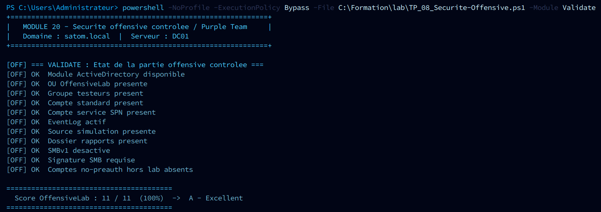 | 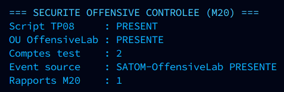 |

## Contents

- [Folder structure](#folder-structure)
- [Lab architecture](#lab-architecture)
- [Included deliverables](#included-deliverables)
- [Lab status](#lab-status)
- [Running the labs](#running-the-labs)
- [Global lab check](#global-lab-check)
- [Delivered screenshots](#delivered-screenshots)
- [Troubleshooting](#troubleshooting)

## Folder structure

```
windows server/
├── README.md
│
├── docs/                              ← documentation
│   ├── formation_ws2025.md            ← full course content (17 modules)
│   ├── formation_ws2025.pdf           ← course PDF
│   └── lab-satom.pdf                  ← lab handout
│
├── lab/                               ← lab scripts (must stay together)
│   ├── START-Formation.ps1            ← single entry point (labs + documentation)
│   ├── Doc-Module.psm1                ← screenshots module + HTML/PDF reports
│   ├── TP_00_Setup-Lab.ps1            ← Modules 00/02 – Post-install, IP, AD DS
│   ├── TP_01_DHCP-DNS-Client.ps1      ← Module 03  – DHCP, DNS, domain join
│   ├── TP_02_AD-OUs-Users-GPO.ps1     ← Modules 04/05/06 – OUs, users, GPOs
│   ├── TP_03_Securite-LAPS-HyperV.ps1 ← Modules 07–15 – LAPS, Sites, security, Hyper-V
│   ├── TP_04_AzureArc-Synthese.ps1    ← Module 16 – Azure Arc + scored validation
│   ├── TP_05_PKI-CA.ps1               ← Module 17 – PKI, CA, LDAPS, auto-enrollment
│   ├── TP_06_FileServer-DFS-FSRM.ps1  ← Module 18 – SMB, DFS, FSRM, network drives
│   ├── TP_07_NPS-RADIUS.ps1           ← Module 19 – NPS, RADIUS, policies, GPO
│   └── TP_08_Securite-Offensive.ps1   ← Module 20 – controlled offensive security
│
├── azure-arc/                         ← Azure Arc scripts
│   ├── azure_arc_prepare.ps1          ← prerequisites (Az modules + azcmagent agent)
│   └── azure_arc_connect_mfa.ps1      ← connection with MFA double authentication
│
├── screenshots/                       ← 55 final screenshots of the lab
│   ├── 01_AD-Domain-Controllers.png
│   ├── 02_DNS-Manager.png
│   ├── ...
│   └── 44_Check-All-Script.png
│
├── scripts/                           ← temporary fix / validation scripts
│   ├── check_all.ps1                  ← global check of the lab state
│   ├── create_pso.ps1                 ← creation of the admins PSO
│   ├── create_nps_policies.ps1        ← creation of the NPS policies
│   └── ...
│
└── archives/                          ← one-shot scripts already run (reference)
    ├── setup.bat
    ├── promote-dc.ps1
    ├── dc01_finalize_lab.ps1
    ├── dc01_dhcp_cleanup_failover.ps1
    ├── dc2_prepare.ps1
    ├── dc2_join_stage.ps1
    ├── dc2_promote.ps1
    ├── dc2_promote_startup.ps1
    ├── dc2_finalize.ps1
    ├── pc01_join.ps1
    └── pc01_join_scheduled.ps1
```

---

## Lab architecture

```
KVM network: 192.168.122.0/24
├── DC01  192.168.122.10   – Windows Server 2025 (PDC Emulator, DNS, DHCP)
│                            Domain: satom.local
├── DC02  192.168.122.20   – Windows Server 2025 (secondary DC, DHCP failover)
└── PC01  192.168.122.50   – Windows Server 2025 (domain client, IP via DHCP)
                             OU: OU=Paris,OU=_SATOM,DC=satom,DC=local
```

**Credentials:**

| Machine | Account | Password |
|---------|--------|--------------|
| DC01 / DC02 | `Administrateur` | `formation123.` |
| PC01 (local LAPS) | `admin` | managed by LAPS — see below |
| Domain users | `satom\<user>` | `Satom@2025!Lab` |

```powershell
# Retrieve the LAPS password of PC01 from DC01:
Get-LapsADPassword -Identity PC01 -AsPlainText
```

---

## Included deliverables

- 55 final screenshots in [screenshots](screenshots)
- complete documentation in [docs/formation_ws2025.md](docs/formation_ws2025.md)
- offensive security lab sheet in [docs/tp08_securite_offensive.md](docs/tp08_securite_offensive.md)
- PDF handout in [docs/formation_ws2025.pdf](docs/formation_ws2025.pdf)
- lab scripts in [lab](lab)
- check and fix scripts in [scripts](scripts)

---

## Lab status

| Module | Component | Status |
|--------|-----------|------|
| M00/02 | AD DS, DNS, DC01 promoted to PDC | ✅ |
| M03 | DHCP scope + FO-DC01-DC02 failover (LoadBalance) | ✅ |
| M04/05 | _SATOM OUs + 12 users + 10 GPOs | ✅ |
| M06 | Password policy + lockout + admins PSO | ✅ |
| M07 | LAPS operational on PC01 | ✅ |
| M08 | AD sites: Site-Paris + Site-Bordeaux + 3 subnets | ✅ |
| M11 | WinGet, PS7, VSCode, Notepad++ + Rapport_AD_Quotidien task | ✅ |
| M12/13 | High-performance plan + Monitoring_Serveur task | ✅ |
| M14 | SMBv1=off, Signing=on, Encrypt=on, LmCompat=5, WDigest=0 | ✅ |
| M15 | Hyper-V: vmms Running, 2 vSwitches, VM-Demo-WS2025 (Gen2) | ✅ |
| M16 | Azure Arc | ⏸️ subscription inactive |
| M17 | Internal PKI: ADCS + CA + LDAPS + Auto-enrollment | ✅ 10/10 A Excellent |
| M18 | File Server: DFS-N, FSRM, quotas, filtering, drives GPO | ✅ 12/12 A Excellent |
| M19 | NPS/RADIUS: NPAS, RADIUS clients, policies, GPO, logs | ✅ 12/12 A Excellent |
| M20 | Controlled offensive security: scenarios, audit, reports | 🧪 ready to run |

Final validation observed with `check_all.ps1`:

- DHCP failover `FO-DC01-DC02` in `Normal` state
- LAPS working on `PC01`
- SMB hardened: `SMBv1=False`, `Signing=True`, `Encrypt=True`
- security registry compliant: `LmCompatibilityLevel=5`, `WDigest=0`
- `PSO-Admins` PSO applied
- Hyper-V active with 2 vSwitches and 1 demo VM

---

## Running the labs

### Quick start (automatic documentation)

```powershell
# On DC01 — PowerShell as Administrator
Set-ExecutionPolicy Bypass -Scope Process -Force
cd C:\Formation\lab

.\START-Formation.ps1 -NomEtudiant "First Last" -Module 0    # AD DS
.\START-Formation.ps1 -NomEtudiant "First Last" -Module 1    # DHCP/DNS
.\START-Formation.ps1 -NomEtudiant "First Last" -Module 2    # OUs/GPOs
.\START-Formation.ps1 -NomEtudiant "First Last" -Module 3    # LAPS/Security/Hyper-V
.\START-Formation.ps1 -NomEtudiant "First Last" -Module 4    # Azure Arc
.\START-Formation.ps1 -NomEtudiant "First Last" -Module 5    # Controlled offensive security

# Chain everything with PDF export:
.\START-Formation.ps1 -NomEtudiant "First Last" -Module Tous -GeneratePDF
```

Reports are generated in: `C:\Users\Administrateur\Desktop\Rapports_Formation\`

---

### Manual execution, script by script

```powershell
# Go to lab/ on DC01
cd C:\Formation\lab

# TP00 — AD DS (reboots automatically)
.\TP_00_Setup-Lab.ps1 -DomainName "satom.local" -ServerName "DC01" `
    -InterfaceAlias "Ethernet" -StaticIP "192.168.122.10"

# TP01 — DHCP + DNS (after the reboot)
.\TP_01_DHCP-DNS-Client.ps1

# TP02 — OUs / Users / GPOs
.\TP_02_AD-OUs-Users-GPO.ps1

# TP03 — Security / LAPS / Hyper-V
.\TP_03_Securite-LAPS-HyperV.ps1                        # everything
.\TP_03_Securite-LAPS-HyperV.ps1 -Module LAPS
.\TP_03_Securite-LAPS-HyperV.ps1 -Module Securite
.\TP_03_Securite-LAPS-HyperV.ps1 -Module HyperV

# TP04 — Validation without Azure
.\TP_04_AzureArc-Synthese.ps1 -ValidationOnly

# TP04 — With Azure Arc (active subscription required)
.\TP_04_AzureArc-Synthese.ps1 `
    -SubscriptionId "your-guid" `
    -TenantId "your-tenant" `
    -ResourceGroup "rg-ws2025-lab" `
    -Location "francecentral"

# TP05 — Complete internal PKI (CA + GPO + LDAPS)
.\TP_05_PKI-CA.ps1

# TP05 — By module
.\TP_05_PKI-CA.ps1 -Module CA        # Install the CA only
.\TP_05_PKI-CA.ps1 -Module LDAPS     # Enable LDAPS only
.\TP_05_PKI-CA.ps1 -Module GPO       # Auto-enrollment GPO only
.\TP_05_PKI-CA.ps1 -Module Validate  # Validation only

# TP06 — File Server: DFS + FSRM + Shares + drives GPO
.\TP_06_FileServer-DFS-FSRM.ps1                          # everything
.\TP_06_FileServer-DFS-FSRM.ps1 -Module Roles            # Roles only
.\TP_06_FileServer-DFS-FSRM.ps1 -Module Shares           # SMB shares only
.\TP_06_FileServer-DFS-FSRM.ps1 -Module DFS              # DFS namespace only
.\TP_06_FileServer-DFS-FSRM.ps1 -Module FSRM             # Quotas + filtering only
.\TP_06_FileServer-DFS-FSRM.ps1 -Module GPO              # Drives GPO only
.\TP_06_FileServer-DFS-FSRM.ps1 -Module Validate         # Validation only
```

---

### TP07 — NPS/RADIUS: network authentication (NPAS + 802.1x)

```powershell
.\TP_07_NPS-RADIUS.ps1                       # everything
.\TP_07_NPS-RADIUS.ps1 -Module Roles         # Install NPAS only
.\TP_07_NPS-RADIUS.ps1 -Module Config        # RADIUS clients + logging
.\TP_07_NPS-RADIUS.ps1 -Module Policy        # Network Policies
.\TP_07_NPS-RADIUS.ps1 -Module GPO           # GPO + RADIUS firewall rules
.\TP_07_NPS-RADIUS.ps1 -Module Validate      # Validation only
```

---

### TP08 — Controlled offensive security / Purple Team

```powershell
.\TP_08_Securite-Offensive.ps1                         # everything: prepare + audit + simulation + detection
.\TP_08_Securite-Offensive.ps1 -Module Prepare         # OU + test accounts
.\TP_08_Securite-Offensive.ps1 -Module Audit           # advanced Windows/AD audit
.\TP_08_Securite-Offensive.ps1 -Module Simulate        # simulations without secret extraction
.\TP_08_Securite-Offensive.ps1 -Module Detect          # Markdown + CSV report
.\TP_08_Securite-Offensive.ps1 -Module Validate        # lab score
.\TP_08_Securite-Offensive.ps1 -Module Cleanup         # cleanup of the OffensiveLab OU

# Lab-only option: creates a deliberately vulnerable AS-REP account,
# to be deleted afterwards with -Module Cleanup.
.\TP_08_Securite-Offensive.ps1 -Module Prepare -EnableVulnerableAccounts
```

---

### Azure Arc (Module 16)

```powershell
# Go to azure-arc/ on DC01
cd C:\Formation\azure-arc

# Step 1 — Install the prerequisites
.\azure_arc_prepare.ps1

# Step 2 — Connect DC01 to Azure Arc (MFA double authentication)
.\azure_arc_connect_mfa.ps1
# → Code 1: initial authentication  (https://microsoft.com/devicelogin)
# → Code 2: MFA step-up for ARM operations
```

---

## Global lab check

```powershell
# From the Linux host:
sshpass -p 'formation123.' ssh Administrateur@192.168.122.10 \
    'powershell -ExecutionPolicy Bypass -File C:\Formation\scripts\check_all.ps1'
```

On DC01:

```powershell
powershell -ExecutionPolicy Bypass -File C:\Formation\scripts\check_all.ps1
```

---

## Delivered screenshots

The final screenshots are stored in [screenshots](screenshots) with full numbering from `01` to `54`, plus two useful variants for screenshots `48` and `53`.

Each screenshot matches a precise check of the lab. The list below explains what each image shows and what it validates.

### 01 to 10 — AD foundation, DNS, DHCP and logical structure

**01 — Domain controllers**  
Shows the presence of the domain servers and validates the base of the Active Directory infrastructure.  


**02 — DNS console**  
Displays the main DNS console and confirms that the DNS role is installed and manageable.  


**03 — Forward DNS zone**  
Validates the forward lookup zone of the `satom.local` domain and its records.  


**04 — Reverse DNS zone**  
Shows the reverse lookup zone used for IP-to-name resolution.  


**05 — Domain information in PowerShell**  
Confirms the Active Directory domain settings from the command line.  


**06 — DHCP scope configuration**  
Shows the LAN DHCP scope and its main settings.  


**07 — DHCP failover**  
Validates the `FO-DC01-DC02` failover relationship in `LoadBalance` mode.  


**08 — Active DHCP leases**  
Displays the clients that received an IP address through DHCP.  


**09 — OU structure**  
Shows the `_SATOM` tree, the sites and the organizational units.  


**10 — IT users**  
Validates the creation of the user accounts in the target OU.  


### 11 to 21 — GPO, LAPS, PKI and LDAPS

**11 — GPO list**  
Displays all the GPOs created for the lab.  


**12 — Password GPO**  
Shows the password policy configured at GPO level.  


**13 — LAPS registry configuration**  
Validates the presence of the LAPS settings on the registry / policy side.  


**14 — AD sites and subnets**  
Displays the `Site-Paris` and `Site-Bordeaux` sites and the subnet mapping.  


**15 — PSO in PowerShell**  
Shows the `PSO-Admins` fine-grained password policy.  


**16 — Certification authority console**  
Validates the AD CS installation and access to the CA console.  


**17 — CA properties**  
Shows the configuration of the certification authority.  


**18 — Root certificate store**  
Confirms the presence of the root certificate in the local store.  


**19 — Issued certificates**  
Displays the certificates issued by the internal CA.  


**20 — LDAPS test in PowerShell**  
Validates listening and connectivity on port `636`.  


**21 — LDAPS connection with LDP**  
Shows a successful graphical LDAPS connection.  


### 22 to 27 — AD groups, FSMO, replication and security GPOs

**22 — AD groups**  
Validates the creation and organization of the security groups.  


**23 — FSMO roles**  
Shows the FSMO roles held by `DC01`.  


**24 — Active Directory replication**  
Confirms the replication state between domain controllers.  


**25 — Account lockout GPO**  
Shows the lockout policy after failed attempts.  


**26 — Default Domain Policy**  
Capture of the default domain policy.  


**27 — PKI auto-enrollment GPO**  
Validates certificate auto-enrollment through group policy.  


### 28 to 33 — File server, DFS, FSRM and network drives

**28 — SMB shares**  
Displays the shares published on the file server.  


**29 — DFS namespace**  
Shows the DFS namespace and its logical structure.  


**30 — ABE on the common share**  
Validates Access-Based Enumeration on the common share.  


**31 — FSRM filtering**  
Shows a file filtering rule through FSRM.  


**32 — FSRM quotas**  
Validates the setup of the storage quotas.  


**33 — Network drives GPO**  
Shows the policy that maps network drives for the users.  


### 34 to 41 — NPS, RADIUS, firewall and security hardening

**34 — NPS console**  
Validates the installation of the NPS / NPAS role.  


**35 — RADIUS clients**  
Shows the devices declared as RADIUS clients.  


**36 — NPS network policies**  
Displays the configured `Network Policies`.  


**37 — Connection request policies**  
Shows the `Connection Request Policies`.  


**38 — RADIUS firewall**  
Validates that the ports required by the RADIUS service are open.  


**39 — SMB security**  
Shows the SMB hardening: signing, encryption, SMBv1 disabled.  


**40 — LSA / WDigest registry**  
Validates the sensitive security settings in the registry.  


**41 — Firewall profiles**  
Displays the state of the Windows firewall profiles.  


### 42 to 44 — LAPS and final validation

**42 — LAPS password of PC01**  
Shows the retrieval of the local administrator secret managed by LAPS.  


**43 — LAPS GPO**  
Validates the settings of the `GPO-LAPS-Configuration` GPO.  


**44 — Final validation `check_all.ps1`**  
Summary capture confirming the overall good state of the lab.  


### 45 to 54 — Controlled offensive security / TP08

**45 — TP08 score**
Shows the validation of the OffensiveLab module with a score of `11/11`.


**46 — OffensiveLab OU and objects**
Shows the `OffensiveLab` OU, the test accounts and the associated group.
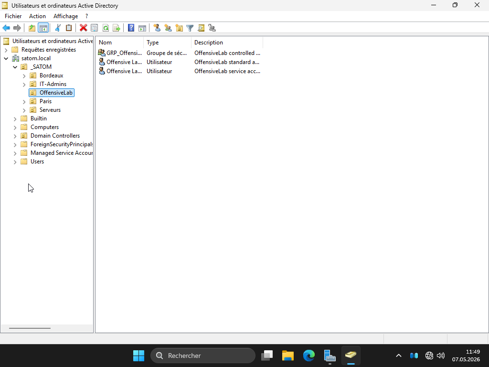

**48 — OffensiveLab events**
Shows the simulation events emitted by the `SATOM-OffensiveLab` source.
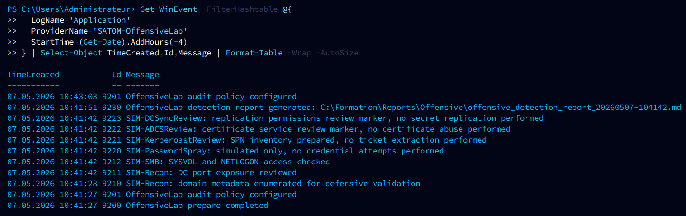

**48 bis — OffensiveLab events in the VM**
Graphical variant from the VM's event viewer.
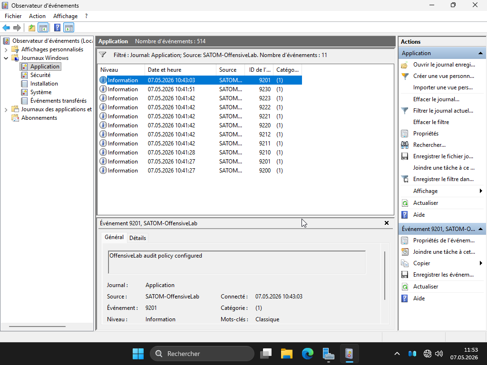

**49 — TP08 Markdown report**
Displays the `offensive_detection_report_*.md` report generated by the lab.
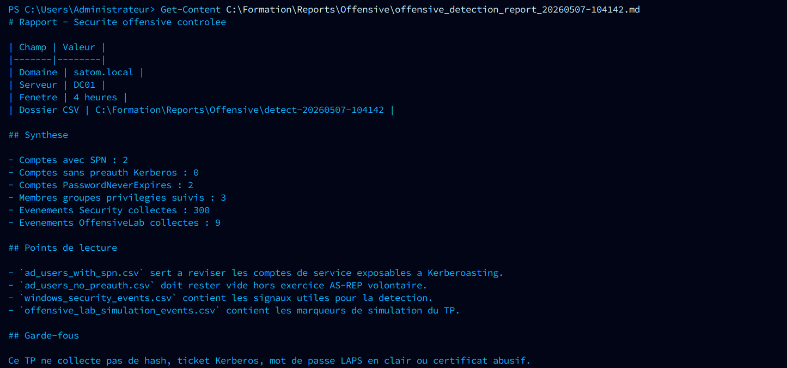

**50 — TP08 CSV exports**
Shows the CSV files produced in the detection folder.
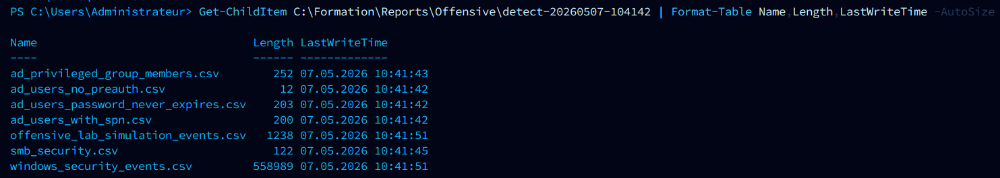

**51 — SPN review**
Displays the service accounts with an SPN used for the Kerberos review.
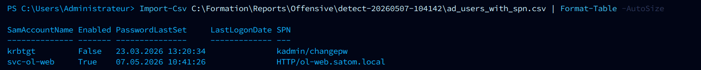

**52 — Accounts without pre-authentication**
Validates that no account without Kerberos pre-authentication exists outside the deliberate exercise.
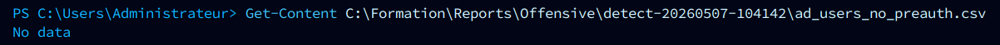

**53 — Audit policy enabled**
Shows the enabled audit categories.
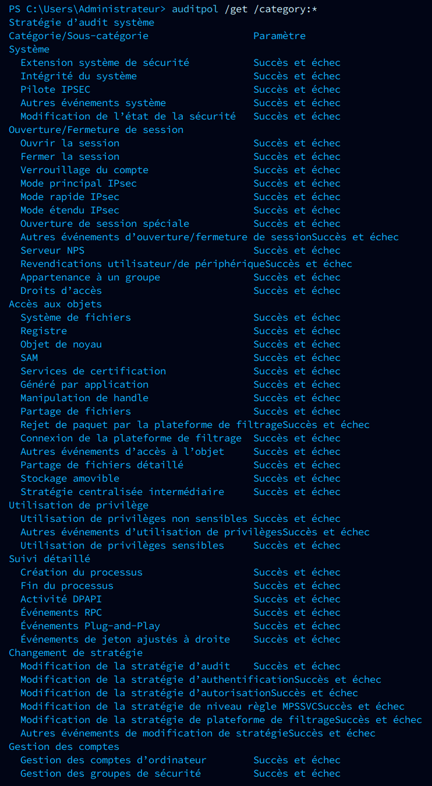

**53 bis — Audit policy summary**
Short variant of the `auditpol` output.
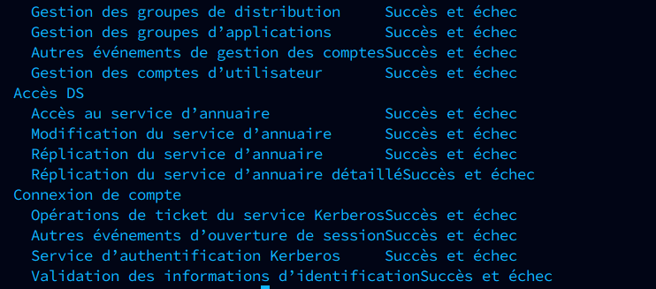

**54 — Global M20 validation**
Shows the `SECURITE OFFENSIVE CONTROLEE (M20)` section in `check_all.ps1`.


---

## Troubleshooting

| Problem | Solution |
|----------|----------|
| AD unavailable after reboot | Wait 2-3 min: `Get-Service ADWS,Netlogon` |
| DHCP does not hand out IPs | `Get-DhcpServerInDC` → authorize if empty |
| Domain join fails | Check that the client's DNS points to DC01 |
| GPO not applied | `gpresult /r` on the client |
| LAPS schema not found | `Update-LapsADSchema` (Schema Admin account) |
| ExecutionPolicy error | `Set-ExecutionPolicy Bypass -Scope Process -Force` |
| Azure Arc — MFA step-up | Use `azure_arc_connect_mfa.ps1` (double device code) |
| Azure Arc — subscription disabled | Re-enable it on portal.azure.com or switch account |
| Validation score < 100% | Re-run the relevant module, check the logs |
